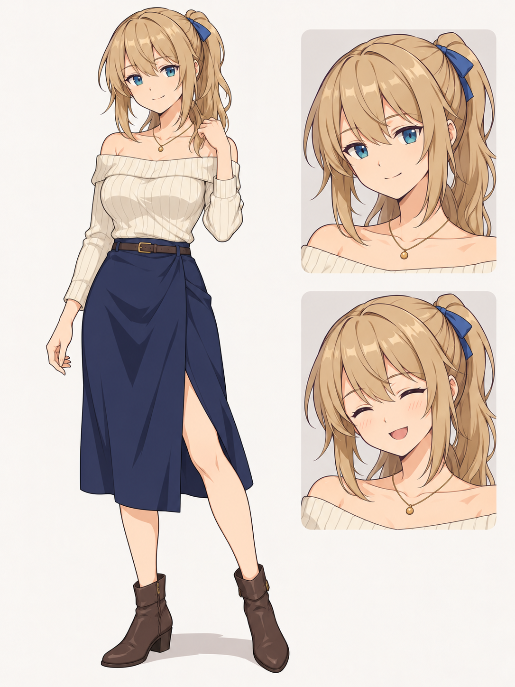

# HGame｜迷宮與她的夜晚（暫名）

成年女性主角的日式回合制 RPG。每章 20 天安排迷宮探索與養成，以普通 RPG 或色色系統攻略迷宮，依善惡、探索與失敗紀錄走向五種結局。

**Unity Demo 0.2.2：連續行走與透明立繪配置**，提供俯視探索、橫向回合制戰鬥及 Windows x64 試玩。按住方向時步態跨格延續、沒有附加搖擺；女主立繪直接疊在右側場景。成人題材以抽象狀態和資源結算呈現，本版沒有露骨腳本或 CG。

## 開始試玩

完整解壓縮 Windows 包，執行 `HGameDemo.exe`。需保留同層 Data、DLL、MonoBleedingEdge 等檔案。新版建置位於 `Builds/HGameDemo-0.2.2`，ZIP 位於 `output/HGameDemo-0.2.2-win64.zip`；兩者是本機產物，不提交 Git。舊版 ZIP 保留。

WASD／方向鍵行走，E／Enter 與面前物件互動，Esc 開選單；戰鬥與視窗使用滑鼠，行動區可滾動。詳見 [操作說明](docs/Demo操作說明.md)。

## Demo 內容與開發

- 第一章 20 天、每日四時段，城鎮準備、三階段迷宮、六個存檔點與 Boss。
- 可行走的城鎮、旅店與兩章測試迷宮；碰撞、鏡頭跟隨、地圖互動、可見接敵與戰後返回。
- 敵左女主右的回合制戰鬥、目標標記、簡易攻擊／受擊／數字與結果頁。
- 劍士／舞者、普通與 H 戰鬥、零 HP 續戰、工作、購物與養成。
- 真實讀檔、特殊記憶、明示分歧、一個魔化技能、隔離主線的畫廊。
- 第二章只提供記憶驗證段與試玩完成頁；其餘職業、風格、正式劇情、CG、五線結局及期限魔化救援尚未納入。

使用 **Unity 6000.3.7f1** 開啟儲存庫根目錄。選單 `HGame/Prepare Demo` 建立／更新場景，開啟 `Assets/_Project/Scenes/Demo.unity` 後按 Play；`HGame/Build Windows Demo` 產生 Windows x64 建置。

規則位於 `Assets/_Project/Core`，不依賴 UnityEngine；Runtime／UI 負責儲存、展示及輸入。五份 JSON 位於 `Assets/_Project/Resources/Demo`。套件版本見 Packages 內 manifest 與 lock 檔。正式 Ink 劇本尚未整合。

0.2.2 的建置、兩尺寸行走量測與布局檢查見 [摘要](verification/0.2.2/summary.md)。0.2.0 的[規則驗證](verification/0.2.0/summary.md)保留，不能當作新版重跑結果。AI 素材見 [紀錄](docs/09-AI素材使用紀錄.md)，本輪兩作的介面參考見 [說明](docs/11-介面與行走參考紀錄.md)。

地圖資料位於 `Resources/Demo/Maps`；行走小人、敵人與地圖均為可替換占位素材，正式地圖與玩法細節等待使用者補充。角色最終造型仍依下方概念參考另行製作。

## 從這裡開始

- [專案總覽與 AI 交接](docs/00-專案總覽-AI交接.md)：目前決策與待確認事項。
- [本輪玩法決策](docs/06-玩法決策紀錄-2026-10-21.md)：完整討論摘要與已淘汰方案。
- [詳細玩法流程圖](docs/07-玩法流程圖.md)：章節、日程、戰鬥、結局與失敗處理。
- [女主人設與暫定造型](docs/08-女主人設與美術參考.md)。
- [AI 素材使用紀錄](docs/09-AI素材使用紀錄.md)。

## 目前方向

- 每章 20 天，每日四時段；早上決定遠征，晚上返城，深夜不得外出。
- 單女主，四種普通職業、兩種色色風格；沒有固定隊友。
- 普通與 H 戰鬥可銜接，主動進入深度模式與被擊倒轉入分開處理。
- 一般、純潔、黑化、色魔、魔化五種結局；部分細部條件尚未定案。
- Unity 6000.3.10f1／URP 2D／Ink 是完整版原技術方向；本次 Demo 依批准規格使用本機 6000.3.7f1，完整 MVP 仍待重估。

## 暫時保留的造型

此圖為 AI 生成概念參考，使用者暫時接受，尚未最終定稿。

## 文件版本

2026-10-21 與 2026-10-22 新決策優先。Demo 規格與計畫均已批准並實作，不將原型設定改為完整版永久決策。原始入口另存於 [歷史總覽](docs/archive/2026-10-20-專案總覽-舊版.md)。未推送或公開發布。
